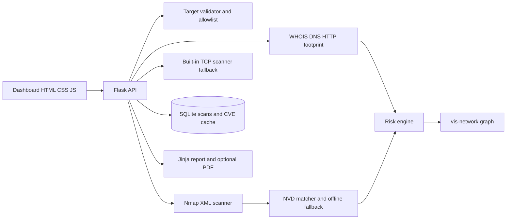
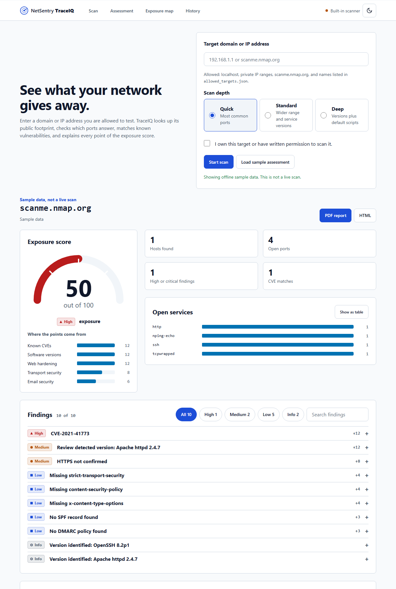

# NetSentry TraceIQ

Context-aware network reconnaissance and exposure mapping for an Ethical Hacking / Network Security college mini project. TraceIQ combines target validation, WHOIS and DNS footprinting, bounded Nmap profiles, explainable exposure scoring, optional NVD CVE matching, an interactive graph, SQLite scan history, comparison, and downloadable reports.

> **Ethical use:** Scan only systems you own or have explicit permission to assess. The application permits loopback and private IP targets, `scanme.nmap.org`, and domains listed in `allowed_targets.json`. Every live scan requires a separate authorization confirmation.

## Setup

### Windows

1. Install Python 3.11 or later. Nmap is optional: install it from [nmap.org/download](https://nmap.org/download) and add it to `PATH` for deeper scans. Without it, TraceIQ uses its built-in TCP scanner.
2. Open PowerShell in this folder and create a virtual environment:

```powershell
py -3.11 -m venv .venv
.\.venv\Scripts\Activate.ps1
python -m pip install --upgrade pip
pip install -r requirements.txt
```

### Linux

Install Python 3.11+, Nmap, and the platform libraries needed by WeasyPrint. For Debian/Ubuntu, `sudo apt install python3.11 python3.11-venv nmap libpango-1.0-0 libcairo2 libgdk-pixbuf-2.0-0 libffi-dev shared-mime-info`.

```bash
python3.11 -m venv .venv
source .venv/bin/activate
python -m pip install --upgrade pip
pip install -r requirements.txt
```

## Run

From this directory:

```bash
python app.py
```

Visit `http://127.0.0.1:5000`. Without Nmap, live scans use the built-in TCP connect scanner (about 100 common ports, basic banner grabbing). For an offline demo, click **Load sample assessment** (or open `/?demo=1`). A live scan requires ticking the authorization box. Private subnets can be scanned by IP; add an explicitly approved domain to `allowed_targets.json` to allow it.

## API

| Method | Endpoint | Purpose |
|---|---|---|
| POST | `/api/scan` | Start an authorized scan (`target`, `profile`, `authorized: true`) |
| GET | `/api/scan/<id>/status` | Poll progress |
| GET | `/api/scan/<id>/results` | Read completed results |
| GET | `/api/scan/<id>/graph` | Get vis-network nodes and edges |
| GET | `/api/scan/<id>/report?format=pdf` | Download PDF (WeasyPrint, then headless Edge/Chrome, then HTML); also `html` and `json` |
| DELETE | `/api/scan/<id>` | Delete a finished scan |
| GET | `/api/demo/report` | Sample report |
| GET | `/api/health` | Engine status |
| GET | `/api/history` | List up to 200 scans |
| GET | `/api/compare?a=<id>&b=<id>` | Compare ports, findings and risk score |
| GET | `/api/demo` | Read offline sample assessment |

## Architecture



## Demo script

1. Start the application and show the ethical-use disclaimer and target allowlist behavior.
2. Load sample data to show the dashboard, score explanation, CVE example, and exposure graph without network access.
3. If Nmap is installed and the course environment allows it, scan `127.0.0.1` or a deliberately prepared private lab VM after confirming authorization.
4. Open scan history, compare two completed scans, and download a report.

## Screenshot



## Tests

```bash
pytest -q
```

45 tests cover target validation and scope, the API lifecycle (scan, results, history, compare, delete, reports), Nmap XML and built-in scanner parsing, CVE matching and caching, scoring, graph building and footprint collection.

## Known limitations

- CVE keyword matches are triage hints; product/version strings may not map exactly to NVD CPE configurations. Confirm with vendor advisories.
- NVD availability and rate limits vary. SQLite cache and a small offline dataset provide limited fallback coverage.
- WHOIS and DNS access depend on local network and resolver configuration. Data sources may return incomplete or stale records.
- Nmap scripts and service detection can be intrusive; Deep mode is limited to approved targets and the top 1000 ports.
- The score is a transparent educational heuristic, not a compliance rating or proof of exploitability.
- PDF export tries WeasyPrint, then headless Edge/Chrome; HTML download remains available if both are missing.
- The dashboard has no external assets: the charts and exposure map are plain SVG, and fonts are system fonts, so it works offline.
- The built-in scanner is a TCP connect scan of common ports only; install Nmap for UDP-free full-range, version and script detection.
